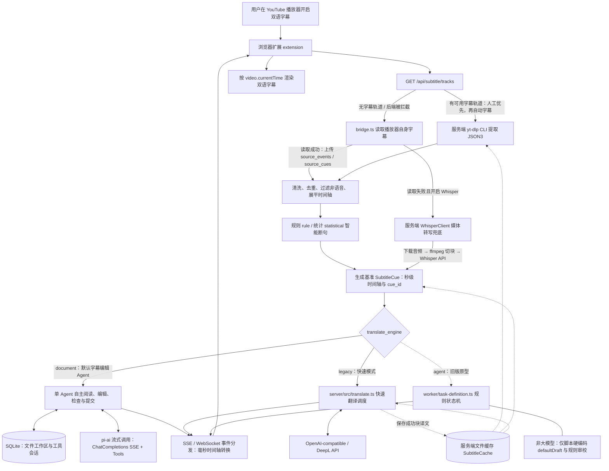

# YouTube 双语字幕翻译架构

根据当前 TypeScript 统一单体服务端与 Worker 源码梳理；明确区分默认的字幕编辑 Agent（`document`）、轻量快速翻译（`legacy`）与旧版规则状态机原型（`agent`）。

> **历史架构图说明**：仓库中保留的 `docs/translation-architecture.png` 为早期 Python 后端经网络中转调度外部 Node Worker 的历史架构设计，仅作历史对比存档参考；当前生产运行架构完全以本文描述的 **TypeScript 统一单体服务（单端口 8787、内置 Worker 内存直连）**为准。

---

## 1. 总体架构



### 核心运行机制说明
1. **单一入口与内存直连**：浏览器扩展默认统一请求 `http://localhost:8787`（通过 `POST /api/subtitle/stream`）。服务端在同进程内直接持有并调度 `AgentWorker` 实例，消除进程间网络跳转。
2. **时间戳规范**：服务端内部算法及 Whisper 原生片段使用秒（seconds）；向外分发给浏览器扩展与播放器前，**严格统一转换为毫秒 (milliseconds)**。
3. **Whisper 兜底边界**：默认关闭；仅在视频无任何人工或自动字幕且用户显式启用时触发，需依赖 yt-dlp 下载音频与 ffmpeg 切块。

---

## 2. 快速翻译模式 (Legacy 流程)

```mermaid
flowchart TD
    C[已断句的原文 cues] --> CACHE[SubtitleCache：读取匹配配置的翻译缓存]
    CACHE --> EARLY[先发 meta 与全部 source_cue，再回传缓存 cue]
    EARLY --> P[收集待翻译字幕]
    P --> MODE{translate_whole 为真，或总条数 >= 100？}
    MODE -->|是| CT[每组 10~12 条：带 [$i] 标记的上下文提示]
    MODE -->|否| BT[每组 12 条：块内逐句并发翻译]
    CT --> RUN[限制并发调用外部 API]
    BT --> RUN
    RUN --> API[调用翻译 API：OpenAI 或 DeepL]
    API --> PARSE[parseWholeResponse：解析 [$i] 索引并回填]
    PARSE --> OUT[逐条推送 cue 事件，写入缓存]
    OUT --> DONE[发送 done，附 failed_cues 统计]
    DONE -->|存在失败，扩展可按需重试| CACHE
```

- **上下文标记与防错位**：针对 OpenAI-compatible 接口使用 `[$i]` 标记，`parseWholeResponse` 严格匹配括号标记并按索引回填；若模型返回行数不全或格式残缺，自动退回逐句补齐，杜绝行号错位。
- **DeepL 适配**：DeepL 不适用 OpenAI 格式提示词，自动分流至逐句并发翻译通道。
- **超时保护**：所有外部 HTTP 请求均由 AbortController 监控，超时覆盖从发起到 Body 完全读取的完整生命周期。

---

## 3. 全文高质量模式 (Document) 与旧版 Agent 原型的边界

### A. 字幕编辑 Agent (`document` 模式)
- **实现位置**：`worker/subtitle-agent.ts`，复用 `worker/document-task.ts` 的持久化、重试和原子发布边界，以及 `worker/document-translation.ts` 的 SSE 传输。
- **驱动方式**：一个真实模型像编码 Agent 一样自主选择读取、搜索、写入、精确编辑与检查工具，不再强制安排分析、分章、审校等固定阶段。模型端点需支持 Chat Completions SSE 与 Function Calling，不要求 `response_format`。
- **工作区**：只读 `source.json` 保存编号、时间轴和原文；可编辑 `translations.json` 保存编号到译文的映射，`notes.md` 保存术语、计划和上下文。它们是 SQLite 持久化的虚拟文件，不开放任意宿主路径、shell 或外网权限。
- **持久化循环**：每个完整模型轮次执行工具后，将文件、修订号和工具会话一起提交；模型可自行继续读取、翻译或修正。超长会话压缩后保留文件和笔记。单次调用总时限 10 分钟，取消即时中断，所有请求与重试消耗预算。
- **发布门禁**：Agent 自查后调用 `validate_translation`，成功验证当前修订才能 `finish_translation`。程序再次核对全部编号、非空译文与原始时间轴后原子发布；普通聊天回答不能提交。
- **质量边界**：程序保证结构与完整性，不保证语义正确。翻译与语义自查由同一个 Agent 完成，不能将结构校验称作独立双语审校。
- **历史兼容**：旧固定阶段 `document_subtitle_translation` 任务继续注册用于恢复；新任务使用 `subtitle_editing_agent` 及独立缓存版本。详见 [字幕编辑 Agent](document-translation.md)。

### B. 旧版 Agent 原型状态机 (`agent` 模式边界声明)
- **实现位置**：`worker/task-definition.ts`。
- **重要边界声明**：**该分支不能宣称为生产级 LLM 翻译 Agent**。
  - `task-definition.ts` 中无外部注入时默认调用 `defaultDraft()` / `reviseDefaultDraft()`，仅为硬编码的占位示例（返回 `[译] 原文`）。
  - 默认审校为 `worker/reviewer.ts` 中的正则规则检查，并非大模型审校。
  - 该模块作为旧版状态机协议原型保留，正式文档翻译请使用 `document` 引擎。

---

## 4. 关键源码位置

| 层级 | 文件路径 | 职责与技术栈 |
| --- | --- | --- |
| **浏览器前端** | `extension/src/content.ts` | 播放器 UI 交互、SSE/WS 客户端、毫秒时钟渲染 |
| **浏览器字幕** | `extension/src/bridge.ts` | 播放器内部 json3 字幕窃听与兜底抓取 |
| **网关服务端** | `server/src/server.ts` | 单体统一服务端入口，负责进程初始化与端口监听 |
| **路由编排** | `server/src/app.ts` | 原生 Node HTTP 路由、SSE 长连接分发、内置 Worker 调度 |
| **缓存层** | `server/src/cache.ts` | 目录隔离、原子写入、LRU 淘汰与 TTL 维护（无死锁设计） |
| **媒体转写** | `server/src/transcribe.ts` & `audio.ts` | ffmpeg 分块、Whisper API 转写及秒级时间轴拼接 |
| **快速翻译** | `server/src/translate.ts` | Legacy 模式快速翻译、`[$i]` 标记解析与超时防护 |
| **字幕断句** | `server/src/subtitle-processing.ts` | 文本清洗、非语音段落过滤、规则与统计智能断句 |
| **字幕编辑 Agent** | `worker/subtitle-agent.ts` | 单 Agent 文件工具、会话、上下文压缩与显式提交 |
| **模型传输与历史流程** | `worker/document-translation.ts` | 共享 SSE 模型调用；保留历史固定阶段流程 |
| **持久化任务边界** | `worker/document-task.ts` | pi-durable 检查点、重试、预算、取消与原子发布 |
| **AgentWorker 核心** | `worker/agent-worker.ts` | 任务队列管理、事件流观察、生命周期调度 |
| **旧版状态机原型** | `worker/task-definition.ts` | 旧版规则状态机测试框架（`defaultDraft` 占位） |
| **[历史兼容实现]** | `backend/src/youtube_ingest/server.py` | 原 Python FastAPI 后端，仅作历史兼容参考保留 |

---

## 5. 部署、环境与安全说明

- **Docker 单容器集成**：`docker-compose.yml` 默认启动单一 `server` 容器（内置 Worker）与辅助 `pot-provider`。旧版独立 Worker 标有 `profiles: [legacy]`，默认不启动。
- **测试环境边界说明**：当前开发环境中宿主机 Docker socket 存在权限限制（`socket permission denied` on `/var/run/docker.sock`），无法连接 Docker 守护进程；本项目不声称已在当前沙箱中实测构建或运行真实 Docker 镜像，所有单元测试与集成测试均在原生 Node 环境执行并使用受控 mock 验证协议健全性。
- **密钥安全与存储边界**：
  - **扩展前端**：用户配置的 `translateApiKey` 与 `whisperApiKey` 会被保存于浏览器本地扩展存储（`chrome.storage.local`）中，用户须保护好本机浏览器 profile 安全。
  - **服务端 / Worker**：请求中携带的密钥仅留存于运行时内存中用于发起 LLM 调用，严格不写入 SQLite 任务数据库（`worker-storage.db`）或磁盘检查点，确保密钥不持久化落盘。
